# LATIHAN PEMROGRAMAN BERORIENTASI OBJEK: THREAD DAN DATABASE PADA JAVA

### Meja Pinjam Lab, Aplikasi Peminjaman Perangkat Laboratorium dengan Java Swing, Thread, dan MySQL


-4479A1?logo=mysql&logoColor=white)


Dua latihan sebelumnya menghasilkan aplikasi Meja Pinjam Lab: yang pertama mencatat perangkat laboratorium, yang kedua menjadikannya meja layanan tempat perangkat dipinjam dan dikembalikan lewat GUI Swing. Keduanya punya satu kelemahan yang sama, yaitu semua data hidup di memori dan hilang begitu jendela ditutup. Latihan ini menutup kelemahan itu. Aplikasi yang sama sekarang menyimpan datanya di database MySQL, dan karena berbicara dengan database butuh waktu, pekerjaan itu dipindahkan ke thread tersendiri supaya jendela tidak membeku.

Ada dua hal baru yang dipelajari. Yang pertama adalah **JDBC dengan pola DAO**: koneksi, `PreparedStatement`, `ResultSet`, dan transaksi (`commit` dan `rollback`) untuk operasi yang harus berhasil atau gagal bersama-sama. Yang kedua adalah **thread**: pekerjaan database berjalan di thread latar, hasilnya diserahkan kembali ke thread Swing lewat `SwingUtilities.invokeLater`, dan selama itu tombol dimatikan serta bilah status menampilkan tulisan *"Menyimpan peminjaman..."*.

---

## Daftar Isi

1. [Identitas](#1-identitas)
2. [Perintah Tugas dan Pemenuhannya](#2-perintah-tugas-dan-pemenuhannya)
3. [Deskripsi Program dan Pengembangan dari Latihan GUI](#3-deskripsi-program-dan-pengembangan-dari-latihan-gui)
4. [Struktur Proyek](#4-struktur-proyek)
5. [Persiapan: Laragon, MySQL, dan Connector/J](#5-persiapan-laragon-mysql-dan-connectorj)
6. [Skema Database](#6-skema-database)
7. [CRUD dengan DAO, Connection, PreparedStatement, ResultSet, dan Transaction](#7-crud-dengan-dao-connection-preparedstatement-resultset-dan-transaction)
8. [Thread: Database di Thread Latar, invokeLater, lalu GUI](#8-thread-database-di-thread-latar-invokelater-lalu-gui)
9. [Klik Tombol, Tombol Nonaktif, Label "Menyimpan..."](#9-klik-tombol-tombol-nonaktif-label-menyimpan)
10. [Cara Menjalankan Program](#10-cara-menjalankan-program)
11. [Screenshot](#11-screenshot)
12. [Catatan dan Batasan](#12-catatan-dan-batasan)

---

## 1. Identitas

| | |
|---|---|
| **Nama** | Jauda Avaro Zufaru |
| **NIM** | F1D02410059 |
| **Kelas** | C |
| **Mata kuliah** | Pemrograman Berorientasi Objek (MBS1302137) |
| **Dosen pengampu** | Royana Afwani, S.T., M.T. |
| **Program studi** | Teknik Informatika, Fakultas Teknik, Universitas Mataram |
| **Tugas** | Java Coding Practice - Thread and Database - 5C |

---

## 2. Perintah Tugas dan Pemenuhannya

Perintah tugas meminta latihan penggunaan *thread* dan *database* pada Java, dengan rincian seperti pada tabel berikut.

| Ketentuan dari perintah tugas | Dipenuhi oleh |
|---|---|
| Mengunduh SQL connector (jar), menyalinnya ke folder project, dan mengimpornya di VS Code | `lib/mysql-connector-j-26.10.0.jar`, terdaftar lewat `.vscode/settings.json` (`java.project.referencedLibraries`) sehingga muncul di **Referenced Libraries**. Langkahnya ada di [bagian 5](#5-persiapan-laragon-mysql-dan-connectorj) |
| CRUD dengan DAO, memuat connection, `PreparedStatement`, transaction, dan `ResultSet` | `KoneksiDb` (connection), `PerangkatDao` dan `PeminjamanDao` (CRUD, `PreparedStatement`, `ResultSet`, `setAutoCommit(false)`, `commit`, `rollback`). Rinciannya di [bagian 7](#7-crud-dengan-dao-connection-preparedstatement-resultset-dan-transaction) |
| Pola database di thread, lalu `invokeLater`, lalu UI/GUI | Method `kerjakan()` di `MejaPinjamFrame.java`: pekerjaan database dijalankan di `new Thread`, hasilnya diserahkan ke GUI lewat `SwingUtilities.invokeLater`. Lihat [bagian 8](#8-thread-database-di-thread-latar-invokelater-lalu-gui) |
| GUI dengan thread: klik tombol, tombol dinonaktifkan, label "Saving..." | `mulaiSibuk()` mematikan tombol aksi dan mengganti label status menjadi *"Menyimpan peminjaman..."* (padanan bahasa Indonesia dari "Saving..."). Lihat [bagian 9](#9-klik-tombol-tombol-nonaktif-label-menyimpan) |
| Repositori GitHub berisi kode, README berisi penjelasan kode, dan screenshot | Repositori ini: `src/`, `README.md` (dokumen ini), dan folder `screenshots/` |

---

## 3. Deskripsi Program dan Pengembangan dari Latihan GUI

Tampilan dan alur penggunaan sengaja dibuat sama dengan latihan GUI sebelumnya supaya terlihat jelas apa yang berubah. Di kiri ada bilah menu gelap, di tengah halaman yang berganti dengan `CardLayout`, dan di bawah bilah status. Enam perangkat awal (INV-01 sampai INV-06) juga sama. Bedanya ada di bagian dalam.

| Aspek | Latihan GUI (sebelumnya) | Latihan ini |
|---|---|---|
| Penyimpanan data | `ArrayList` di memori, hilang saat aplikasi ditutup | Tabel `perangkat` dan `peminjaman` di MySQL, tetap ada setelah aplikasi ditutup |
| Peminjaman dan pengembalian | Mengubah objek di memori | Transaksi database yang mengubah dua tabel sekaligus |
| Menjalankan operasi | Langsung di thread Swing | Di thread latar, tombol dinonaktifkan selama menunggu |
| Struktur kode | Satu paket, empat kelas | Tujuh berkas dalam satu folder `src`: satu `Main`, dua model, satu kelas koneksi, dua DAO, dan satu kelas GUI |
| Kelas pendukung data | `Peminjaman` menyimpan rujukan objek `Perangkat` | `Peminjaman` menyimpan kode perangkat; relasinya dijaga *foreign key* di database |

Ada tiga halaman. **Rak Perangkat** menampilkan enam kartu perangkat dengan stok tersedia, dibaca dari database; klik pada kartu membuka formulir dengan perangkat itu terpilih. **Formulir Pinjam** berisi nama, NIM, perangkat, jumlah, dan pernyataan tanggung jawab; tombol *Catat Peminjaman* baru aktif setelah pernyataan dicentang. **Buku Pinjaman** menampilkan semua transaksi, dengan tombol *Terima Pengembalian* dan *Hapus Riwayat*. Bilah status di bawah menampilkan apa yang sedang atau baru saja terjadi.

---

## 4. Struktur Proyek

```
Latihan Thread dan Database pada Java/
├── .vscode/
│   └── settings.json              # mendaftarkan src, bin, dan jar di lib
├── lib/
│   └── mysql-connector-j-26.10.0.jar
├── sql/
│   └── schema.sql                 # membuat database, tabel, dan data awal
├── src/
│   ├── Main.java                  # titik masuk program
│   ├── MejaPinjamFrame.java       # GUI Swing dan pola thread
│   ├── Perangkat.java             # model: satu perangkat beserta stoknya
│   ├── Peminjaman.java            # model: satu transaksi peminjaman
│   ├── KoneksiDb.java             # membuka koneksi ke MySQL
│   ├── PerangkatDao.java          # akses tabel perangkat
│   └── PeminjamanDao.java         # akses tabel peminjaman (transaksi)
├── screenshots/                   # tangkapan layar untuk README
└── README.md
```

Pembagian tugasnya sederhana. `Perangkat` dan `Peminjaman` hanya menyimpan data. `KoneksiDb` hanya tahu cara membuka koneksi. Dua DAO adalah satu-satunya tempat perintah SQL ditulis. `MejaPinjamFrame` tidak pernah menulis SQL; ia hanya memanggil DAO. Dengan begitu, kalau suatu hari database diganti, yang disentuh hanya DAO.

Program dimulai dari `Main.java`:

```java
public class Main {
    public static void main(String[] args) {
        // jendela dibuat di thread Swing (EDT) lewat invokeLater, sama seperti aturan untuk semua update GUI
        SwingUtilities.invokeLater(() -> new MejaPinjamFrame());
    }
}
```

---

## 5. Persiapan: Laragon, MySQL, dan Connector/J

Tiga hal harus siap sebelum program bisa jalan: server MySQL menyala, database dan tabelnya ada, dan driver JDBC terpasang di proyek.

### 5.1 Menyalakan MySQL lewat Laragon

Laragon adalah paket server lokal yang menyertakan MySQL. Buka Laragon, lalu klik **Start All**. Setelah menyala, MySQL mendengarkan di port `3306`. Pengguna bawaannya `root` dengan kata sandi kosong, sesuai isi `KoneksiDb.java`.

### 5.2 Membuat database dan tabel

Buka phpMyAdmin dari Laragon, pilih tab **SQL**, tempel seluruh isi `sql/schema.sql`, lalu klik **Kirim**. Skrip ini membuat database `meja_pinjam_lab`, kedua tabel, dan enam perangkat awal. Skrip aman dijalankan berulang kali karena memakai `CREATE ... IF NOT EXISTS` dan `INSERT IGNORE`, jadi tabel tidak dibuat ulang dan data awal tidak digandakan. Database lain di MySQL yang sama tidak tersentuh.

### 5.3 Menambahkan SQL connector ke proyek

Java tidak bisa berbicara dengan MySQL tanpa *driver*, yaitu pustaka yang menerjemahkan perintah JDBC ke protokol MySQL. Untuk MySQL, driver itu bernama **MySQL Connector/J**. Langkahnya:

1. Unduh berkas `.jar` Connector/J dari situs resmi MySQL atau dari Maven Central (`com.mysql:mysql-connector-j`). Berkas yang dipakai di proyek ini adalah versi **26.10.0**.
2. Salin ke folder `lib/` di dalam proyek.
3. Daftarkan ke VS Code. Di panel **Java Projects**, buka bagian **Referenced Libraries**, klik tanda **+**, lalu pilih jar tadi. Cara lainnya adalah mengisi `.vscode/settings.json`, yang sudah dilakukan di proyek ini:

```json
{
    "java.project.sourcePaths": ["src"],
    "java.project.outputPath": "bin",
    "java.project.referencedLibraries": ["lib/**/*.jar"]
}
```

Setelah itu jar tampil di **Referenced Libraries** dan VS Code bisa mengompilasi serta menjalankan program yang memakai JDBC. Saat dijalankan dari terminal, jar harus disertakan lewat `-cp` (lihat [bagian 10](#10-cara-menjalankan-program)).

Integritas jar sudah dicocokkan dengan nilai *checksum* SHA-1 yang dipublikasikan Maven Central, yaitu `6394cd2713b8bfb8c6692a1ca92bff5ddb939415`.

---

## 6. Skema Database

Database `meja_pinjam_lab` terdiri dari dua tabel yang berhubungan satu-ke-banyak: satu perangkat bisa muncul di banyak transaksi peminjaman.

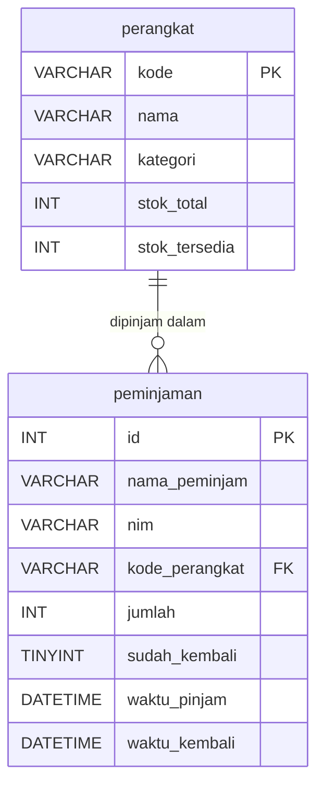

Beberapa keputusan perancangan yang sengaja dibuat:

- **`CHECK (stok_tersedia >= 0 AND stok_tersedia <= stok_total)`** membuat database sendiri menolak stok minus. Aplikasi sudah memeriksanya, tetapi aturan yang penting sebaiknya dijaga di lapisan terakhir juga.
- **`FOREIGN KEY ... ON UPDATE CASCADE`** menjamin sebuah transaksi tidak bisa merujuk perangkat yang tidak ada.
- **`waktu_kembali DATETIME NULL`** bernilai `NULL` selama perangkat belum kembali.
- Mesin penyimpanan **InnoDB**, karena hanya InnoDB yang mendukung transaksi dan *foreign key*.

Data awal setelah `schema.sql` dijalankan:

| kode | nama | kategori | stok_total | stok_tersedia |
|---|---|---|---|---|
| INV-01 | PC Rakitan Core i5 | Komputer | 6 | 6 |
| INV-02 | Raspberry Pi 4 | Komputer | 4 | 4 |
| INV-03 | Switch 8 Port | Jaringan | 3 | 3 |
| INV-04 | Kabel UTP Cat6 | Jaringan | 10 | 10 |
| INV-05 | Proyektor Portabel | Periferal | 2 | 2 |
| INV-06 | Webcam USB | Periferal | 1 | 1 |

---

## 7. CRUD dengan DAO, Connection, PreparedStatement, ResultSet, dan Transaction

*DAO* (Data Access Object) adalah kelas yang membungkus semua perintah SQL untuk satu tabel. Bagian ini menelusuri empat hal yang diminta tugas satu per satu, dengan kode aslinya.

### 7.1 Connection

`KoneksiDb` membuka koneksi baru setiap kali dipanggil. Yang memanggil bertanggung jawab menutupnya, dan cara paling aman adalah `try-with-resources`.

```java
public class KoneksiDb {
    private static final String URL = "jdbc:mysql://localhost:3306/meja_pinjam_lab?useSSL=false&allowPublicKeyRetrieval=true";
    private static final String USER = "root";
    private static final String PASS = "";

    public static Connection ambil() throws SQLException {
        try {
            Class.forName("com.mysql.cj.jdbc.Driver");   // memastikan driver dari file jar di lib sudah termuat
        } catch (ClassNotFoundException e) {
            throw new SQLException("Driver MySQL tidak ditemukan. Pastikan jar di folder lib sudah masuk Referenced Libraries.", e);
        }
        return DriverManager.getConnection(URL, USER, PASS);
    }
}
```

`Class.forName` memastikan driver dari jar benar-benar termuat, dan kalau jar belum terdaftar, pesan galatnya langsung menyebut penyebabnya.

### 7.2 Read: PreparedStatement dan ResultSet

`PerangkatDao.semua()` membaca seluruh baris tabel `perangkat`. `PreparedStatement` menyiapkan perintah SQL, `executeQuery()` menjalankannya dan menghasilkan `ResultSet`, lalu `rs.next()` maju satu baris demi satu baris. Ketiganya dibuka di dalam `try (...)` sehingga otomatis tertutup.

```java
public ArrayList<Perangkat> semua() throws SQLException {
    ArrayList<Perangkat> hasil = new ArrayList<>();
    String sql = "SELECT kode, nama, kategori, stok_total, stok_tersedia FROM perangkat ORDER BY kode";
    try (Connection c = KoneksiDb.ambil();
         PreparedStatement ps = c.prepareStatement(sql);
         ResultSet rs = ps.executeQuery()) {
        while (rs.next()) {
            hasil.add(new Perangkat(rs.getString("kode"), rs.getString("nama"), rs.getString("kategori"),
                    rs.getInt("stok_total"), rs.getInt("stok_tersedia")));
        }
    }
    return hasil;
}
```

`PeminjamanDao.semua()` bekerja sama, hanya saja SQL-nya menggabungkan (`JOIN`) tabel `peminjaman` dengan `perangkat` supaya nama perangkat ikut terbaca.

### 7.3 Create, Update, Delete: parameter dengan `?`

Nilai yang berasal dari pengguna tidak pernah ditempel ke teks SQL. Ia dipasang lewat tanda `?` dan `setInt`/`setString`, sehingga aman dari SQL injection. Contoh paling sederhana adalah **Delete**:

```java
public void hapus(int id) throws SQLException {
    String sql = "DELETE FROM peminjaman WHERE id = ? AND sudah_kembali = 1";
    try (Connection c = KoneksiDb.ambil();
         PreparedStatement ps = c.prepareStatement(sql)) {
        ps.setInt(1, id);
        if (ps.executeUpdate() == 0) {
            throw new IllegalStateException("Hanya riwayat yang sudah dikembalikan yang bisa dihapus.");
        }
    }
}
```

`executeUpdate()` mengembalikan jumlah baris yang berubah. Syarat `sudah_kembali = 1` membuat riwayat yang masih dipinjam tidak bisa dihapus, karena menghapusnya akan membuat stok tidak cocok. Kalau tidak ada baris yang terhapus, DAO melempar `IllegalStateException` berisi pesan yang akan ditampilkan GUI.

### 7.4 Transaction: dua tabel, satu kesatuan

Meminjam mengubah dua tabel sekaligus: stok di `perangkat` berkurang dan satu baris baru masuk ke `peminjaman`. Kalau langkah pertama berhasil tetapi langkah kedua gagal, stok akan berkurang tanpa ada catatan peminjamannya. Karena itu keduanya dibungkus transaksi.

```java
public int pinjam(String nama, String nim, String kodePerangkat, int jumlah) throws SQLException {
    try (Connection c = KoneksiDb.ambil()) {
        c.setAutoCommit(false);   // mulai transaction
        try {
            // 1. kurangi stok HANYA jika masih cukup (pengecekan dan pengurangan dalam satu perintah)
            PreparedStatement ps1 = c.prepareStatement(
                    "UPDATE perangkat SET stok_tersedia = stok_tersedia - ? WHERE kode = ? AND stok_tersedia >= ?");
            ps1.setInt(1, jumlah);
            ps1.setString(2, kodePerangkat);
            ps1.setInt(3, jumlah);
            if (ps1.executeUpdate() == 0) {
                throw new IllegalStateException("Stok " + kodePerangkat + " tidak cukup untuk " + jumlah + " unit.");
            }
            ps1.close();

            // 2. catat transaksinya, lalu ambil id yang dibuat otomatis oleh database
            PreparedStatement ps2 = c.prepareStatement(
                    "INSERT INTO peminjaman (nama_peminjam, nim, kode_perangkat, jumlah, sudah_kembali, waktu_pinjam) "
                            + "VALUES (?, ?, ?, ?, 0, NOW())", Statement.RETURN_GENERATED_KEYS);
            // ... setString/setInt untuk keempat tanda ?
            ps2.executeUpdate();
            ResultSet kunci = ps2.getGeneratedKeys();
            kunci.next();
            int idBaru = kunci.getInt(1);

            c.commit();   // keduanya berhasil, simpan permanen
            return idBaru;
        } catch (SQLException | RuntimeException e) {
            c.rollback();   // salah satu gagal, stok kembali seperti semula
            throw e;
        }
    }
}
```

Urutannya: `setAutoCommit(false)` memulai transaksi, `commit()` menyimpan semua perubahan sekaligus, dan `rollback()` membatalkan semuanya kalau ada yang gagal. Ada dua detail yang layak diperhatikan. Pertama, pengecekan stok dan pengurangannya digabung dalam satu perintah `UPDATE ... WHERE stok_tersedia >= ?`, jadi tidak ada celah di antara "cek" dan "kurangi" yang bisa dimanfaatkan peminjam lain pada saat yang sama; kalau tidak ada baris yang berubah, stok memang tidak cukup. Kedua, `Statement.RETURN_GENERATED_KEYS` meminta id yang dibuat otomatis oleh database, yang dipakai untuk membentuk kode seperti `PJM-007`.

`kembalikan(id)` memakai pola yang sama. Ia mengunci baris peminjaman dengan `SELECT ... FOR UPDATE` agar satu transaksi tidak bisa dikembalikan dua kali pada waktu bersamaan, lalu menandainya sudah kembali dan menambah stok, semuanya dalam satu transaksi.

Ringkasan operasinya:

| Operasi | Method | Perintah SQL | Transaksi |
|---|---|---|---|
| Create | `PeminjamanDao.pinjam()` | `UPDATE perangkat` + `INSERT INTO peminjaman` | Ya |
| Read | `PerangkatDao.semua()`, `PeminjamanDao.semua()` | `SELECT` (dengan `JOIN`) | Tidak perlu |
| Update | `PeminjamanDao.kembalikan()` | `SELECT ... FOR UPDATE` + `UPDATE peminjaman` + `UPDATE perangkat` | Ya |
| Delete | `PeminjamanDao.hapus()` | `DELETE` | Tidak perlu |

---

## 8. Thread: Database di Thread Latar, invokeLater, lalu GUI

### 8.1 Masalahnya

Swing hanya punya satu thread untuk menggambar jendela dan menjalankan semua *event handler*, yaitu **Event Dispatch Thread (EDT)**. Kalau akses database dikerjakan langsung di handler tombol, EDT ikut menunggu database, dan selama menunggu jendela tidak bisa digambar ulang atau diklik: tampilannya membeku. Aturan keduanya berlawanan, dan inilah yang membuat polanya perlu dua arah: pekerjaan yang lama **tidak boleh** di EDT, tetapi komponen Swing **hanya boleh** disentuh dari EDT.

### 8.2 Polanya

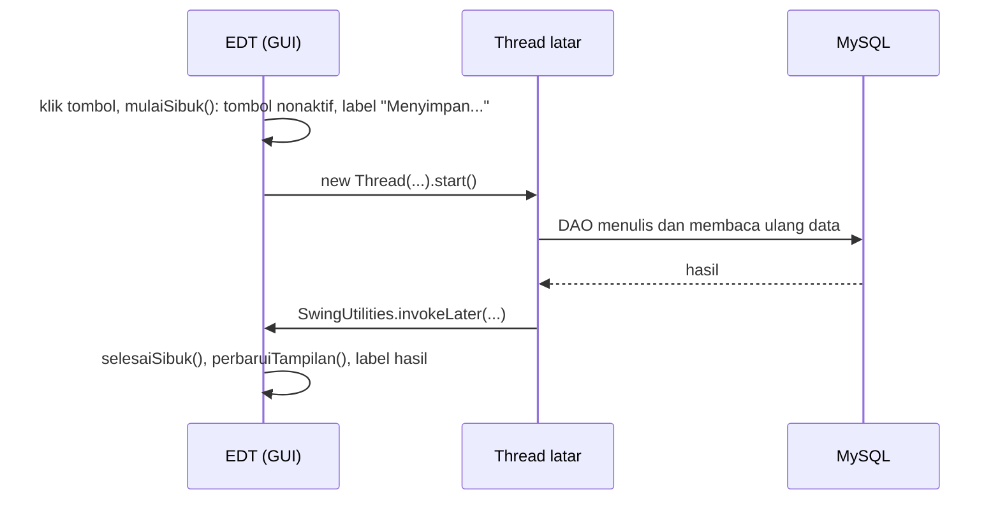

Pola ini ditulis sekali di method `kerjakan()` dan dipakai oleh semua operasi (memuat data, meminjam, mengembalikan, menghapus):

```java
private void kerjakan(String pesanSibuk, boolean pakaiJeda, Operasi operasi, Runnable setelahBerhasil) {
    mulaiSibuk(pesanSibuk);   // masih di EDT: tombol nonaktif dan label "Menyimpan..."

    new Thread(() -> {
        // ---- dari sini berjalan di thread latar, DILARANG menyentuh komponen Swing ----
        try {
            if (pakaiJeda) {
                Thread.sleep(JEDA_SIMULASI);
            }
            String pesan = operasi.jalankan();                     // tulis ke database
            ArrayList<Perangkat> perangkat = perangkatDao.semua(); // baca ulang dari database
            ArrayList<Peminjaman> pinjam = peminjamanDao.semua();

            SwingUtilities.invokeLater(() -> {
                // ---- kembali ke EDT, aman menyentuh komponen Swing ----
                daftarPerangkat = perangkat;
                daftarPinjam = pinjam;
                selesaiSibuk();
                perbaruiTampilan();
                labelStatus.setText(pesan);
                if (setelahBerhasil != null) {
                    setelahBerhasil.run();
                }
            });
        } catch (IllegalStateException e) {
            // aturan data dilanggar (stok kurang, dsb), pesannya aman ditampilkan
            SwingUtilities.invokeLater(() -> {
                selesaiSibuk();
                labelStatus.setText("Ditolak: " + e.getMessage());
                JOptionPane.showMessageDialog(frame, e.getMessage(), "Tidak Bisa Diproses", JOptionPane.WARNING_MESSAGE);
            });
        } catch (SQLException e) {
            // ... selesaiSibuk(), dialog galat dengan saran memeriksa Laragon dan schema.sql, lewat invokeLater
        } catch (InterruptedException e) {
            Thread.currentThread().interrupt();
        }
    }).start();
}
```

Perhatikan bahwa semua yang menyentuh komponen Swing (`selesaiSibuk()`, `perbaruiTampilan()`, `labelStatus.setText(...)`, dan `JOptionPane`) berada di dalam `invokeLater`, termasuk di jalur galat. Bagian di luar `invokeLater` hanya berurusan dengan DAO dan data biasa.

Bagian "apa yang dikerjakan" dioper sebagai lambda ke interface kecil `Operasi`, sehingga tiap operasi cukup menulis isinya saja. Contoh memanggilnya dari `catatPeminjaman()`:

```java
kerjakan("Menyimpan peminjaman...", true, () -> {
    int id = peminjamanDao.pinjam(nama, nim, p.getKode(), jumlah);
    return String.format("Peminjaman PJM-%03d berhasil disimpan.", id);
}, () -> {
    fieldNama.setText("");
    fieldNim.setText("");
    fieldJumlah.setText("1");
    cekSetuju.setSelected(false);
    bukaHalaman("BUKU");
});
```

Lambda pertama dijalankan di thread latar dan mengembalikan pesan untuk bilah status; lambda kedua dijalankan di EDT setelah berhasil, untuk mengosongkan formulir dan membuka Buku Pinjaman.

Terakhir, setelah setiap operasi data dibaca ulang dari database (`perangkatDao.semua()` dan `peminjamanDao.semua()`), sehingga yang tampil di layar selalu sama dengan isi database, bukan hasil perkiraan di memori.

---

## 9. Klik Tombol, Tombol Nonaktif, Label "Menyimpan..."

Perintah tugas meminta: saat tombol diklik, tombol dinonaktifkan dan sebuah label menampilkan "Saving...". Dua method kecil mengurusnya.

```java
// Langkah awal: nonaktifkan tombol aksi supaya tidak bisa diklik dua kali, lalu tampilkan pesan
private void mulaiSibuk(String pesan) {
    sibuk = true;
    btnCatat.setEnabled(false);
    btnKembali.setEnabled(false);
    btnHapus.setEnabled(false);
    labelStatus.setText(pesan);
}

// Langkah akhir: tombol aktif lagi
private void selesaiSibuk() {
    sibuk = false;
    btnKembali.setEnabled(true);
    btnHapus.setEnabled(true);
    btnCatat.setEnabled(cekSetuju.isSelected());   // tombol Catat tetap bergantung pada check box
}
```

`mulaiSibuk()` dipanggil di baris pertama `kerjakan()`, jadi tombol sudah mati sebelum thread latar dimulai. Mematikan tombol bukan hanya soal tampilan: ia mencegah pengguna mengklik dua kali dan memicu dua transaksi yang sama. `selesaiSibuk()` mengaktifkannya lagi baik ketika berhasil maupun gagal. Tombol *Catat Peminjaman* punya satu syarat tambahan, yaitu pernyataan tanggung jawab harus tetap dicentang, itu sebabnya ia memakai `cekSetuju.isSelected()` dan tidak langsung `true`.

MySQL di komputer sendiri menyelesaikan satu perintah dalam hitungan milidetik, sehingga tombol yang nonaktif dan tulisan "Menyimpan..." lewat terlalu cepat untuk terlihat. Karena itu ada jeda buatan sebelum menyentuh database:

```java
private static final int JEDA_SIMULASI = 1500;   // milidetik; isi 0 untuk mematikan jeda
```

Jeda ini dijalankan di thread latar (`Thread.sleep`), bukan di EDT, jadi jendela tetap responsif selama jeda. Ini jeda peragaan saja; pada aplikasi sungguhan ia dihapus. Memuat data awal saat aplikasi dibuka tidak memakai jeda (`pakaiJeda = false`).

---

## 10. Cara Menjalankan Program

Kebutuhan: JDK 8 atau lebih baru, MySQL (Laragon) yang menyala dengan `sql/schema.sql` sudah dijalankan, dan jar Connector/J di folder `lib/`.

**Melalui Visual Studio Code**, buka folder proyek, buka `src/Main.java`, lalu klik **Run** di atas method `main`. Karena jar sudah terdaftar sebagai *Referenced Libraries*, tidak ada pengaturan lain.

**Melalui terminal**, dari dalam folder proyek:

```bash
# Windows (pemisah classpath adalah titik koma)
javac -d bin -cp "lib/*" src\*.java
java -cp "bin;lib/*" Main

# Linux / macOS (pemisah classpath adalah titik dua)
javac -d bin -cp "lib/*" src/*.java
java -cp "bin:lib/*" Main
```

Jika aplikasi menampilkan dialog galat saat dibuka, penyebab paling umum adalah MySQL belum dinyalakan (klik **Start All** di Laragon), `schema.sql` belum dijalankan, atau jar belum terdaftar di Referenced Libraries. Pesan pada dialog menyebut yang mana.

---

## 11. Screenshot

### 1. Halaman Rak Perangkat
Enam perangkat dimuat dari tabel `perangkat` saat aplikasi dibuka; bilah status menulis "Terhubung ke database."

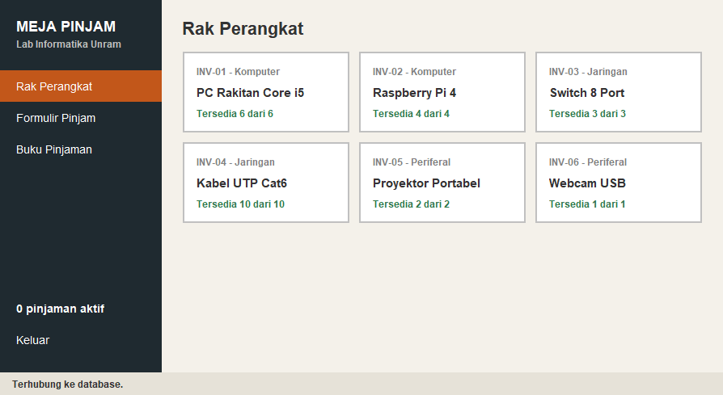

### 2. Formulir Pinjam Terisi
Nama, NIM, dan jumlah sudah diisi, pernyataan tanggung jawab dicentang sehingga tombol *Catat Peminjaman* aktif.


### 3. Menyimpan di Thread Latar
Setelah tombol diklik, tombol *Catat Peminjaman* menjadi nonaktif dan bilah status menulis "Menyimpan peminjaman...", sementara database dikerjakan di thread latar.

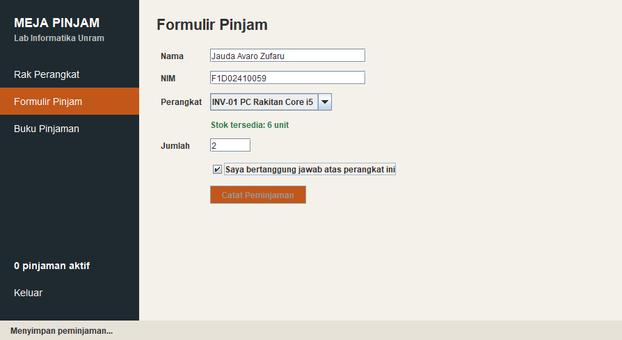

### 4. Buku Pinjaman
Setelah selesai, hasil kembali ke GUI lewat `invokeLater`: halaman berpindah ke Buku Pinjaman dan transaksi baru tampil dengan status DIPINJAM.

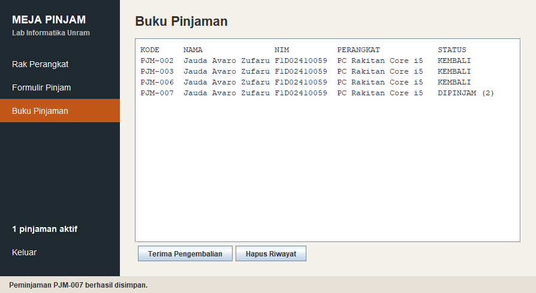

### 5. Stok Berkurang di Rak
PC Rakitan Core i5 sekarang "Tersedia 4 dari 6", karena dua unit dipinjam. Angka ini dibaca ulang dari database.

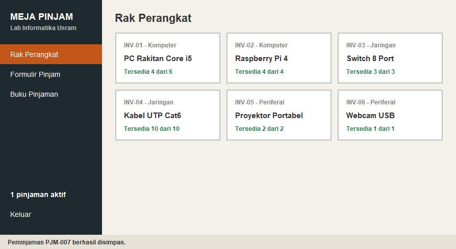

### 6. Stok Tidak Cukup
Meminta lima unit padahal tersedia empat ditolak sebelum menyentuh database.

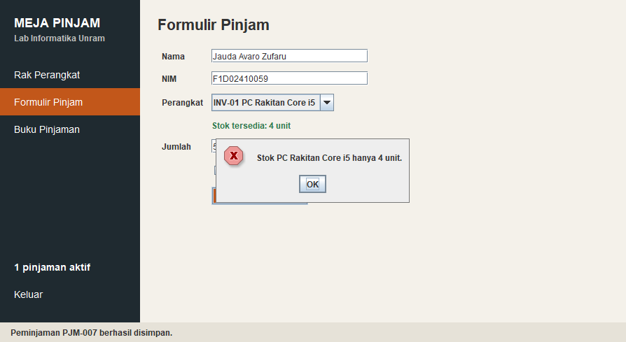

### 7. Dialog Pengembalian
*Terima Pengembalian* membuka daftar transaksi yang masih dipinjam.

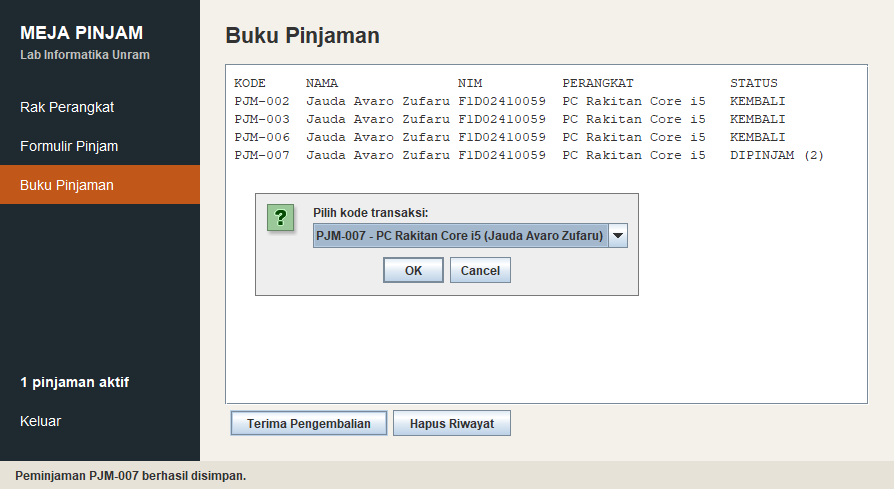

### 8. Menyimpan Pengembalian
Selama pengembalian diproses, tombol *Terima Pengembalian* dan *Hapus Riwayat* nonaktif dan bilah status menulis "Menyimpan pengembalian...".

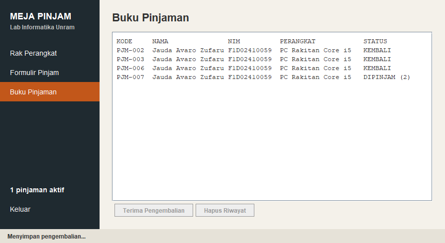

### 9. Pengembalian Berhasil
Status transaksi menjadi KEMBALI, stok bertambah lagi, dan ringkasan menunjukkan "0 pinjaman aktif".


### 10. Dialog Hapus Riwayat
Hanya riwayat yang sudah dikembalikan yang ditawarkan untuk dihapus.

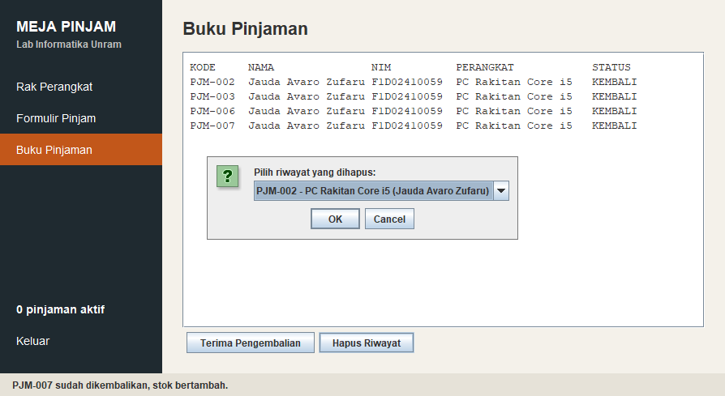

### 11. Menghapus Riwayat
Operasi Delete memakai pola thread yang sama: tombol nonaktif dan tulisan "Menghapus riwayat...".

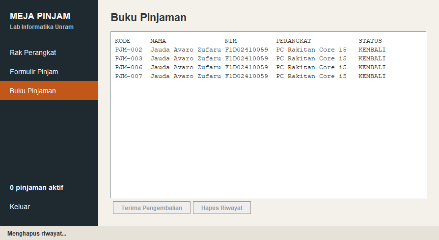

### 12. Riwayat Terhapus
Baris riwayat yang dipilih hilang dari Buku Pinjaman, dan bilah status mengonfirmasi penghapusannya.


---

## 12. Catatan dan Batasan

Aplikasi ini sengaja dibatasi pada materi thread dan database. Beberapa hal yang perlu diketahui:

- Koneksi dibuka baru setiap operasi lewat `DriverManager`, tanpa *connection pool*. Untuk aplikasi satu pengguna dengan MySQL lokal hal ini cukup, tetapi aplikasi yang melayani banyak pengguna sebaiknya memakai pool seperti HikariCP.
- Alamat, pengguna, dan kata sandi database ditulis langsung di `KoneksiDb.java`. Nilai bawaan Laragon (`root`, tanpa kata sandi) hanya layak untuk lingkungan belajar di komputer sendiri; di aplikasi sungguhan nilai ini dipisahkan ke berkas konfigurasi.
- Satu transaksi peminjaman hanya untuk satu jenis perangkat, dan validasi NIM sebatas memastikan kolomnya tidak kosong.
- Jeda `JEDA_SIMULASI` adalah jeda buatan khusus peragaan (lihat [bagian 9](#9-klik-tombol-tombol-nonaktif-label-menyimpan)). Mengisinya `0` menghilangkan jeda tanpa mengubah bagian lain.
- Penjagaan stok ada di database (`UPDATE ... WHERE stok_tersedia >= ?` dan `CHECK`), bukan hanya di Java, sehingga dua jendela aplikasi yang dibuka bersamaan tetap tidak bisa membuat stok menjadi minus.
- Nomor transaksi (`PJM-001`, `PJM-002`, dan seterusnya) berasal dari kolom `AUTO_INCREMENT`, jadi nomor tidak dipakai ulang setelah riwayat dihapus atau setelah transaksi dibatalkan oleh `rollback`.
